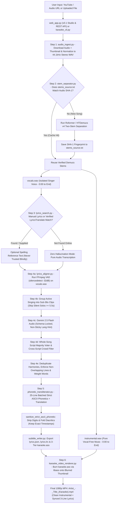
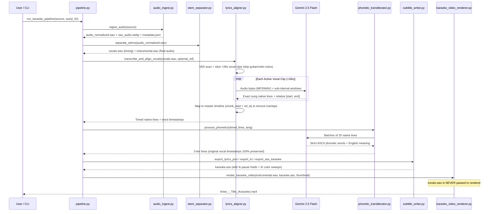
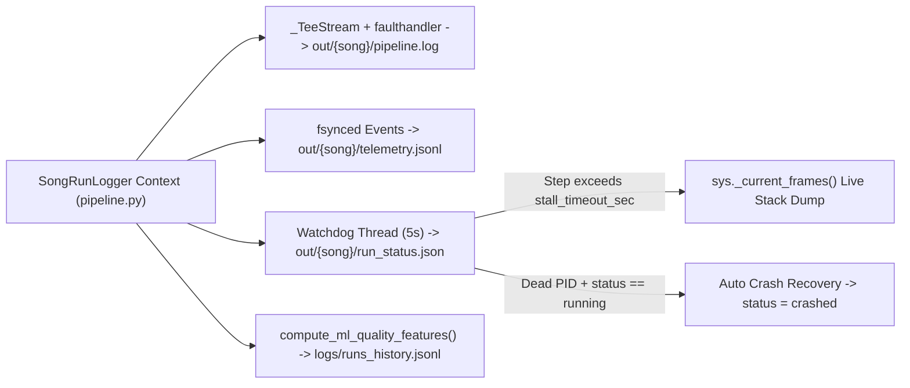
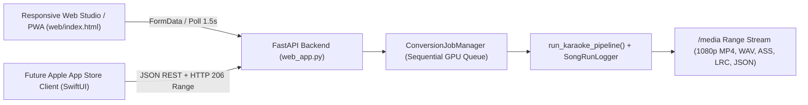
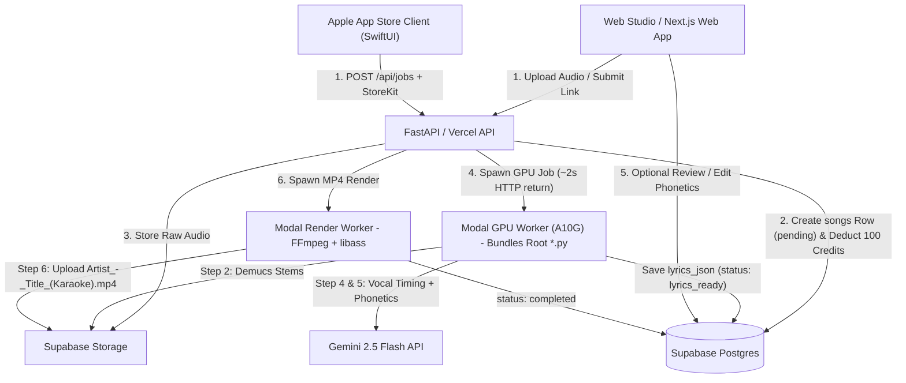

# AI Multilingual Karaoke Agent — Software Blueprint & Architecture Documentation

> [!IMPORTANT]
> **Core Engineering Principle: Split-Track Vocal Timing**
> To guarantee **100% accurate lyrics & timestamps** *and* **zero singer vocals in the final video**, the pipeline separates the song into two synchronized timelines immediately after ingestion:
> 1. **`vocals.wav` (Timing Track — Used Only by AI, Never Mixed into Video):** Isolated singer voice used to detect vocal phrases, skip instrumental solos, and transcribe/time every sung word directly from the audio.
> 2. **`instrumental.wav` (Playback Track — Kept for Final Video):** Pure vocal-free backing music combined with the saved vocal timestamps to render the final 1080p karaoke MP4.

---

## 1. End-to-End Program Flowchart



---

## 2. Data & Timing Sequence Across Modules



---

## 3. Step-by-Step Program Logic

### Step 1: Audio Ingestion & Folder Isolation (`audio_ingest.py` & `karaoke_cli.py`)
- **Per-Song Folder Isolation:** `source_folder_name()` extracts the 11-character YouTube ID (`yt_<videoId>`) or URL SHA-1 hash so different songs never overwrite or reuse each other's cached files.
- **Clean Download:** Deletes any leftover `raw_audio.*` files in the target folder, downloads best-quality audio + cover thumbnail via `yt-dlp`, and probes exact duration via `ffprobe`.
- **Standardized Normalization:** Converts input audio into `audio_normalized.wav` (`44.1 kHz`, stereo `2ch`, `16-bit PCM`) so downstream stem separation and timestamps share an exact sample-accurate clock.

### Step 2: AI Vocal & Instrumental Stem Separation (`stem_separator.py`)
- **Audio Fingerprint Cache:** Computes `_audio_fingerprint()` (file size + SHA-1 of the first 4 MB) and compares it against `stems_source.txt`. Cached Demucs stems (`htdemucs/<song>/no_vocals.wav` and `vocals.wav`) are reused **only** if the fingerprint matches the current song.
- **Clean Two-Stem Split:** Runs MelBand-Roformer or HTDemucs v4 (`--two-stems=vocals`) to produce:
  - `vocals.wav`: Isolated human singing voice on the exact `0.00s -> duration` timeline.
  - `instrumental.wav`: Copied directly from Demucs `no_vocals.wav` so zero lead vocals enter the final video.

### Step 3: Anti-Hallucination Reference Lyrics Check (`lyrics_search.py`)
- **Query Cleaning:** `clean_song_query()` strips `// Album // Year`, `|`, `Vol. X`, `[Official Video]`, `4K`, and 4-digit years before searching LyricsTranslate.
- **Zero Blind Guessing:** Never asks an LLM to guess lyrics from a song title alone. If verified text is not found online (or if `--non-interactive` is used without matches), the pipeline relies directly on the singer's voice in Step 4. If reference lyrics are supplied (`--lyrics`), they are treated strictly as an optional spelling hint—never forced onto sections where they aren't sung.

### Step 4: Vocal-First Transcription, Solo Skipping & Precision Timing (`lyrics_aligner.py`)
1. **Sequential VAD State Machine (`extract_vocal_intervals_vad`):**
   - Scans `vocals.wav` with `silencedetect=noise=-32dB:d=0.35`.
   - Captures early intro vocals (`0.0s–5.0s`) and end-of-song fade-out vocals while discarding silent instrumental intros and solos.
2. **Drift-Free, Solo-Skipping Chunker (`group_intervals_into_chunks`):**
   - Splits chunks across any silent instrumental break $\ge 5.5\text{s}$ (e.g., 25–45s guitar/violin solos are completely skipped so zero fake lines can appear during solos).
   - Caps every audio clip below `36.0s` (`< 60s`), which eliminates both cumulative timestamp drift across 4–5 minute songs and `MM:SS` vs. raw-seconds formatting ambiguity.
3. **Schema-Locked Multimodal Vocal Listening (`transcribe_chunk_with_gemini`):**
   - Slices each active vocal window into mono 96kbps MP3 bytes in memory (`pipe:1`) and sends the audio + acoustic sub-interval boundaries + track title/artist context to **Gemini 2.5 Flash Multimodal Audio** (`temperature=0.05`) using a strict `google.genai.types.Schema` (`response_schema`).
   - **Zero Prompt Echoing & Concert Crowd Guard:** System prompts contain **zero** concrete song lyric examples (preventing few-shot echoing during live concert crowd applause or guitar bleed) and explicitly return `{"language": "none", "lines": []}` on crowd noise, instruments, or wordless `"aaah"`/`"oooh"` vocalizations.
   - **Non-Sticky Chunk Language Hints:** Each chunk receives `explicit_lang_hint` independently so an ambiguous intro chunk can never poison downstream chunks' language hints.
4. **Whole-Song Script Majority Voting & Outlier Filtering (`resolve_dominant_language_and_filter_outliers`):**
   - Votes across **all** chunks of the song using Unicode script codepoints (`[\u0530-\u058F]` Armenian vs. `[\u0600-\u06FF]` Persian/Arabic) and Persian-specific vs. Arabic-specific orthographic markers (`پ چ ژ گ ک ی \u200c` vs. `ة ى أ إ ؤ ك ي`).
   - Strips cross-script noise hallucinations (when dominant script $\ge 65\%$ of native words) and rapid $\ge 4\times$ wordless interjection loops (`آه`, `Ա՜խ`) before normalization.
5. **Non-Overlapping Normalization (`normalize_and_build_words`):**
   - Deduplicates simultaneous harmony overlaps (`< 0.40s` start delta with `> 60%` overlap).
   - Enforces `line[i].end <= line[i+1].start - 0.05s` so two lines never collide on screen.
   - Distributes word timestamps within each line weighted by character length and punctuation breath pauses (`,`, `՝`, `;`).

### Step 5: Strict ASCII Phonetic Romanization & 3-Tier Subtitles (`phonetic_transliterator.py` & `subtitle_writer.py`)
- **Batched Transliteration:** Processes timed lines in batches of `25` via Gemini 2.5 Flash (with deterministic offline `CHAR_MAP` fallback for Arabic, Persian, and Armenian), locking `"native"` strictly to Step 4's transcribed vocal words.
- **Strict ASCII Enforcement (`sanitize_strict_ascii_phonetic`):** Folds any stray diacritics (`ā -> aa`, `ī -> ee`, `ū -> oo`, `ḥ -> h`, `š -> sh`, `ə -> uh`) and Arabizi digits (`3 -> a`, `7 -> h`, `5 -> kh`, `2 -> '`, `8 -> gh`) into plain English `A–Z` letters while keeping Step 4's `[start, end]` timestamps 100% untouched.
- **Gap-Accurate 3-Slot Center-Focused Rolling `.ass` Karaoke Generation (`export_ass_karaoke`):**
  - Renders a **3-Slot Teleprompter Rolling Stage** (`Top Fading Previous [Line i-1]` + `Center Active [Line i]` + `Bottom Rising Next [Line i+1]`) across `1920x1080`:
    1. **Top Slot (`Line i-1` — Fading Out Previous Line, when gap $\le 4.0\text{s}$):** `KaraokePrevNative` (`48pt` Bold at `y=195 -> 170`), `KaraokePrevPhonetic` (`54pt` Bold at `y=265 -> 240`), and `KaraokePrevTranslation` (`32pt` Italic at `y=325 -> 300`) gently drift upward (`\move`) and dissolve (`\fad(0,fade_ms)`) over the first `~1.8s` of `Line i`.
    2. **Center Slot (`Line i` — Main Active Line):** Dead-center `KaraokeNative` (`68pt` Bold at `y=465`, slightly smaller than Latin), `KaraokePhonetic` (`74pt` Bold at `y=555` with `{\K<cs>}` sweeps and `{\k<gap_cs>}` pause holds), and `KaraokeTranslation` (`42pt` Italic at `y=635`) at `100%` brightness (`\fad(140,140)`).
    3. **Bottom Slot (`Line i+1` — Appearing Next Line, when gap $\le 6.0\text{s}$):** `KaraokeNextNative` (`52pt` Bold at `y=785 -> 760`), `KaraokeNextPhonetic` (`58pt` Bold at `y=860 -> 835`), and `KaraokeNextTranslation` (`34pt` Italic at `y=925 -> 900`) rise smoothly (`\move` + `\fad(320,120)`) into the lower preview slot.

### Step 6: Hard-Burned 1080p MP4 Video Rendering (`karaoke_video_renderer.py`)
- **Libass Auto-Detection:** Automatically selects Python's bundled `imageio_ffmpeg` binary (compiled with `libass`, `HarfBuzz`, and `FriBidi` for complex Arabic/Persian RTL shaping and Armenian glyphs) when macOS system `ffmpeg` lacks `libass`.
- **Stage Backdrop & Vocal-Free Muxing:** Scales and blurs the song's cover art (`boxblur=10:5` + `45%` dark contrast layer), hard-burns `karaoke.ass` directly into `yuv420p` H.264 video frames, and mixes **only `instrumental.wav`** (`320kbps AAC`) into `<Artist>_-_<Title>_(Karaoke).mp4`.

### Cross-Cutting Layer: Per-Song Logging, Freeze/Crash Watchdog & ML Telemetry (`pipeline_logger.py`)
Every song run is wrapped inside `SongRunLogger` so errors, hangs, hard crashes, and performance metrics are automatically persisted:



- **Per-Song Execution Files (`out/<song_folder>/`):**
  1. `pipeline.log`: Millisecond-timestamped stdout/stderr mirror plus Python tracebacks and C-level `faulthandler` segfault/OOM dumps.
  2. `telemetry.jsonl`: Structured event stream (`run_start`, `step_start`, `step_end`, `step_error`, `stall_warning`, `crash_recovered`, `run_summary`) flushed with `os.fsync`.
  3. `run_status.json`: Atomically replaced (`os.replace`) state + heartbeat snapshot containing `pid`, `current_step`, `last_heartbeat_at`, `stage_durations_sec`, and `error`.
- **Freeze / Hang Watchdog:** A daemon thread updates `last_heartbeat_at` every `5s` (automatically paused while waiting for interactive CLI prompts via `pause_watchdog_for_input()`). If any step exceeds its `stall_timeout_sec`, it captures the **live main-thread Python call stack** (`sys._current_frames()`) into `pipeline.log` and `telemetry.jsonl` (`stall_warning`).
- **Hard-Crash (`SIGKILL` / OOM) Detection:** `detect_and_recover_stale_run()` and `python3 karaoke_cli.py --check-logs` check `is_pid_alive(pid)` on any `"running"` status file—marking dead-PID runs `"crashed"` and flagging live-PID stale-heartbeat runs `"frozen"`.
- **Global ML Dataset (`logs/runs_history.jsonl`):** Appends one structured feature row per run (`realtime_factor`, `peak_rss_mb`, `stage_durations_sec`, `lines_count`, `words_count`, `vocal_coverage_ratio`, `overlap_violations_count`, `ascii_phonetic_compliance_rate`, `translation_coverage_rate`, `stem_cache_hit`, `alignment_method`) for performance optimization and anomaly detection.

### Interface Layer: v0.1 Web Studio & Mobile-Ready REST API (`web_app.py` & `web/`)
`web_app.py` exposes a unified **FastAPI + Static PWA Studio** designed to run identically on a local Mac/PC (`http://127.0.0.1:8000`), on a custom domain (`--host 0.0.0.0`), and as the JSON REST backend for a future **Apple App Store (iOS/SwiftUI)** client:



- **REST & OpenAPI Endpoints (`/docs`):**
  - `POST /api/jobs` (`202 Accepted`): Accepts either multipart `FormData` (YouTube URL or uploaded `.mp3`/`.wav`/`.m4a`/`.flac`) or `application/json` payloads for mobile clients.
  - `GET /api/jobs/{job_id}`: Live step progress (`0–100%`), elapsed time, watchdog health (`healthy` / `stall_warning` / `frozen` / `crashed`), and `pipeline.log` tail.
  - `GET /api/songs` & `GET /api/songs/{song_folder}`: Completed song library, 3-tier word-synced `lines`, and download URLs.
  - `GET /media/{song_folder}/{file}`: Supports `206 Partial Content` HTTP byte-range streaming required by macOS/iOS Safari `<video>` and `AVPlayer`.
  - `GET /api/health`: System health + `scan_all_song_runs()` crash/freeze telemetry summary.

---

## 4. Module Reference & File Layout

```text
Karaoke_Agent/
├── web_app.py                   # v0.1 FastAPI Web Studio & iOS-ready REST API server
├── web/                         # Responsive light/dark PWA frontend (zero build step)
│   ├── index.html               # Studio UI: song converter, live watchdog progress, 1080p player & library
│   ├── styles.css               # System light/dark tokens, 48px touch targets & :user-invalid validation
│   ├── app.js                   # Live job polling, click-to-seek 3-tier lyrics & library controller
│   ├── manifest.webmanifest     # Installable PWA / iOS Home Screen web manifest
│   └── icon.svg                 # Vector app icon
├── karaoke_cli.py               # CLI entry point (--source, --lyrics, --lang, --non-interactive, --check-logs)
├── pipeline.py                  # Master 6-step orchestrator wrapped in SongRunLogger
├── pipeline_logger.py           # Per-song logs, watchdog freeze stack dumper, crash recovery & ML telemetry
├── audio_ingest.py              # yt-dlp downloader, URL ID folder naming & 44.1kHz WAV normalizer
├── stem_separator.py            # Roformer / HTDemucs vocal separator + SHA-1 stem cache guard
├── lyrics_search.py             # Metadata cleaner & verified LyricsTranslate lookup
├── lyrics_aligner.py            # VAD scanner, <36s solo-skipping chunker, Gemini Audio & script voter
├── lyrics_transcriber.py        # Optional local Whisper / WhisperX fallback ASR
├── phonetic_transliterator.py   # Batched Gemini + offline rule-based strict ASCII romanizer
├── subtitle_writer.py           # Exports lyrics.json, enhanced lyrics.lrc & 3-tier karaoke.ass
├── karaoke_video_renderer.py    # 1080p H.264 + libass hard-burned video renderer
├── SOFTWARE_BLUEPRINT.md        # Complete architecture, logic & flowcharts (this document)
├── logs/
│   └── runs_history.jsonl       # Cross-song ML performance, quality & crash dataset
├── tests/
│   └── test_pipeline_steps.py   # 18 automated unit, anti-contamination & Web API tests (Steps 1-8)
└── Serverless_implementation/   # Cloud deployment stack (Vercel + Supabase + Modal)
    ├── migrations/
    │   └── 001_initial_schema.sql
    └── modal/
        └── modal_worker.py
```

---

## 5. Data Format Specification (`lyrics.json`)

```json
{
  "metadata": {
    "title": "Mohsen Yeganeh - Behet Ghol Midam ( I promise you )",
    "artist": "Mohsen Yeganeh",
    "language": "fa",
    "duration_seconds": 284.82
  },
  "lines": [
    {
      "line_id": 0,
      "start": 31.05,
      "end": 34.40,
      "native": "خودت می‌خوای بری خاطره شی",
      "phonetic": "Khodet mikhay beri khaatereh shi",
      "translation": "You yourself want to leave and become a memory",
      "words": [
        { "native": "خودت", "phonetic": "Khodet", "start": 31.05, "end": 31.68 }
      ]
    }
  ]
}
```

---

## 6. Automated Verification Suite (`tests/test_pipeline_steps.py`)

Run all 18 verification checks anytime with:
```bash
python3 tests/test_pipeline_steps.py
```

| Test Class | Verified Invariants |
| :--- | :--- |
| **`TestStep1AudioIngest`** | Distinct `yt_<videoId>` folder isolation; safe filename sanitization; `44.1kHz` stereo `pcm_s16le` WAV normalization. |
| **`TestStep2StemSeparation`** | SHA-1 fingerprint mismatch triggers fresh separation; matching fingerprint reuses cached stems; center vocals attenuated `< 0.002` RMS in `instrumental.wav`. |
| **`TestStep3LyricsSearchAntiHallucination`** | Strips `// Album // Vol.3 // 1998` tags; returns `found=False` without fabricating lyrics when unmatched online. |
| **`TestStep4VocalFirstTimingAndAlignment`** | Captures early (`<5s`) and end-of-track singing; skips 15s silent guitar solos; keeps chunks `< 40s`; deduplicates harmonies; prevents prompt-echo & cross-script crowd hallucinations (`test_mohsen_yeganeh_cross_script_and_prompt_echo_prevention`). |
| **`TestStep5PhoneticsAndSubtitles`** | Zero digits (`0–9`) or diacritics in phonetic output; 1:1 preservation of vocal timestamps; `.ass` emits `{\k<gap_cs>}` pause holds across breath pauses. |
| **`TestStep6VideoRenderAndFullPipeline`** | Full 6-step pipeline renders `1920x1080` MP4, writes per-song + global ML telemetry, and proves center singer vocals are absent from MP4 audio. |
| **`TestStep7TelemetryCrashAndFreezeDetection`** | Captures failed step & traceback on error; dumps live main-thread stack on freeze/stall; recovers dead-PID (`SIGKILL`/OOM) crashes; flags frozen live-PID runs. |
| **`TestStep8WebStudioAndAPI`** | Verifies HTML5 Studio UI, PWA manifest, `/api/health`, file-upload `POST /api/jobs` -> `completed`, `/api/songs/{folder}`, and `206 Partial Content` HTTP Range video streaming for macOS/iOS Safari. |

---

## 7. Roadmap: Local v0.1 -> Custom Domain -> Cloud & Apple App Store

1. **Stage 1 — Local Studio (`v0.1`, Ready Today):** Run `python3 web_app.py` on macOS/Linux at `http://127.0.0.1:8000` with local GPU/MPS stem separation and instant library playback.
2. **Stage 2 — Custom Domain Web App:** Run `python3 web_app.py --host 0.0.0.0 --port 8000` behind Caddy/Nginx HTTPS (`CORS_ORIGINS=https://yourdomain.com`), or scale heavy GPU jobs via `Serverless_implementation/modal/modal_worker.py`.
3. **Stage 3 — Apple App Store (iOS / iPadOS Native App):** Point a SwiftUI client (`AVPlayer` + synchronized `lines` model) directly at `/api/jobs`, `/api/songs`, and Range-enabled `/media/.../*.mp4` (documented interactively at `/docs`), or wrap the installable PWA via Capacitor/SwiftUI with Sign in with Apple + StoreKit 2 credits.



- **Credits Economy:** `500` free signup credits (`profiles.credits`); `100` credits per song (all-inclusive: stem separation, vocal timing, interactive web player, and 1080p MP4 export) with automatic refund on failure (`credits_refunded` guard).
- **Deduplication Cache (`song_cache`):** Keyed by `source_hash` so previously processed songs return stems and timed `lyrics_json` immediately without re-running GPU separation.
